## operaciones basicascon open cv

## Santiago pacheco Nc 0113

## open cv
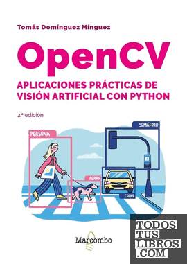

## imagen original
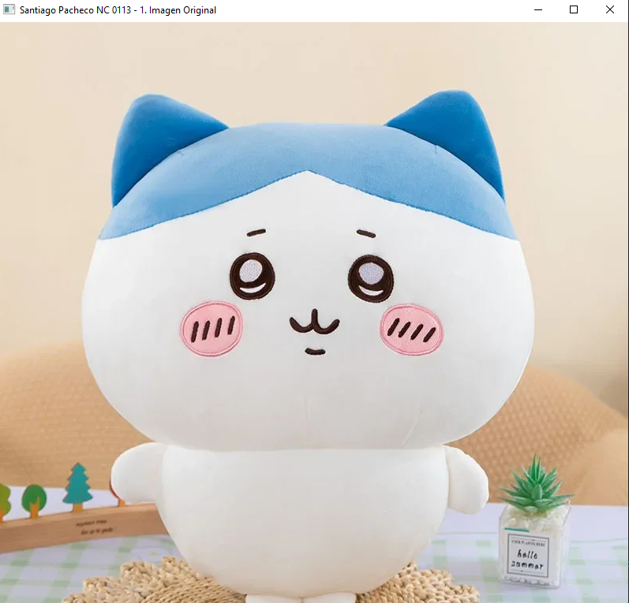

## pixel modificado
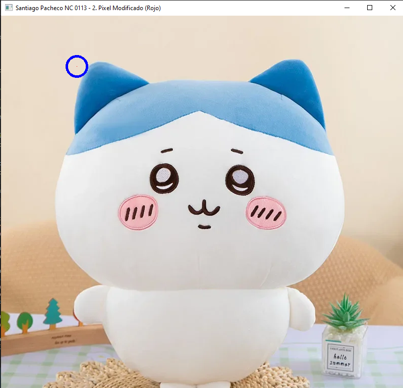

## imagen con roi marcada
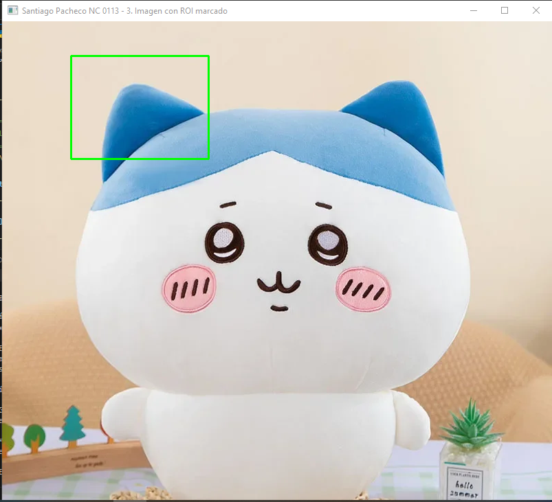

## roi
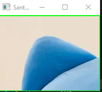

## escala de grises
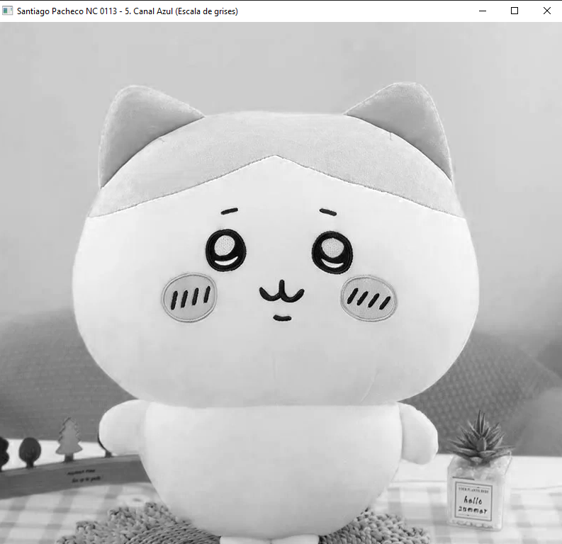
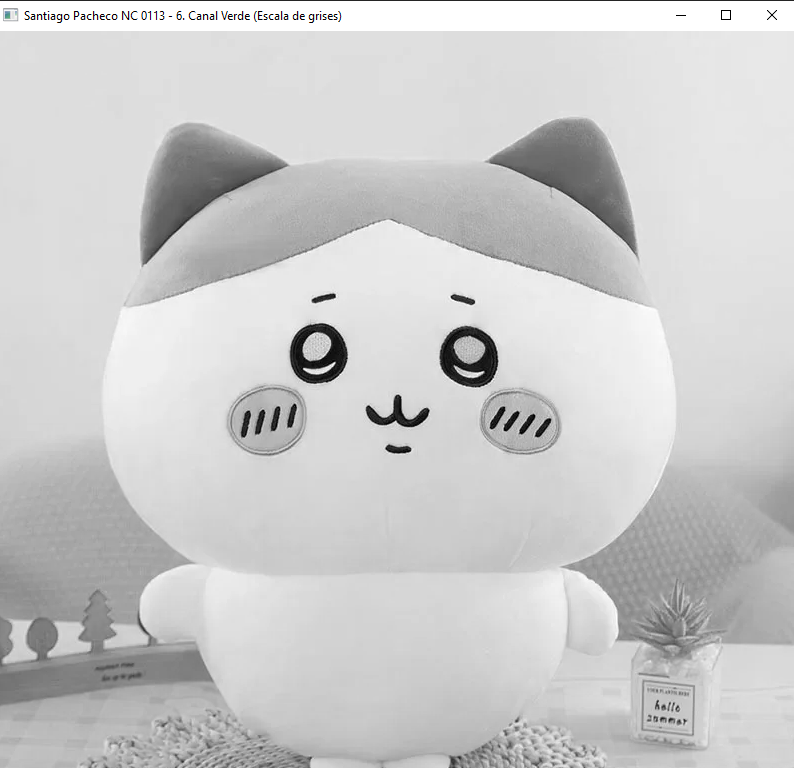
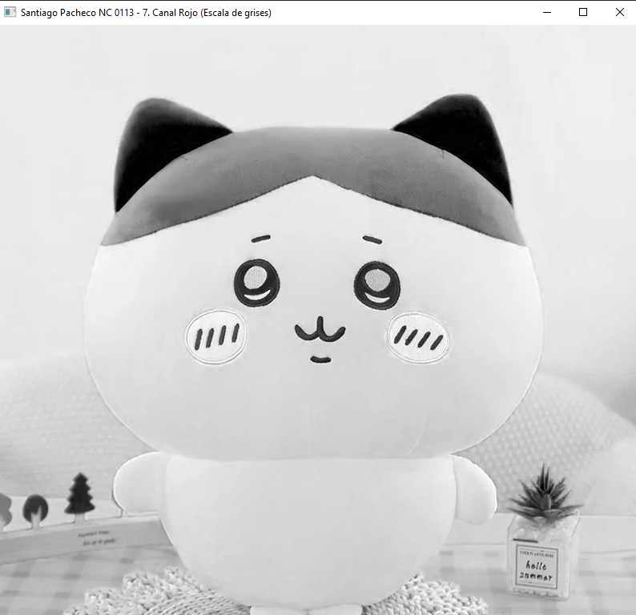

## canales verdes,azules y rojo
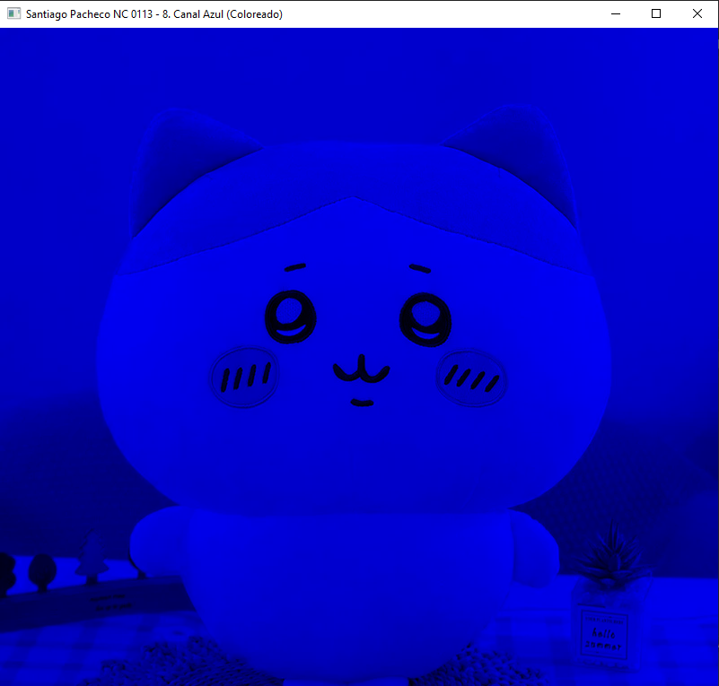
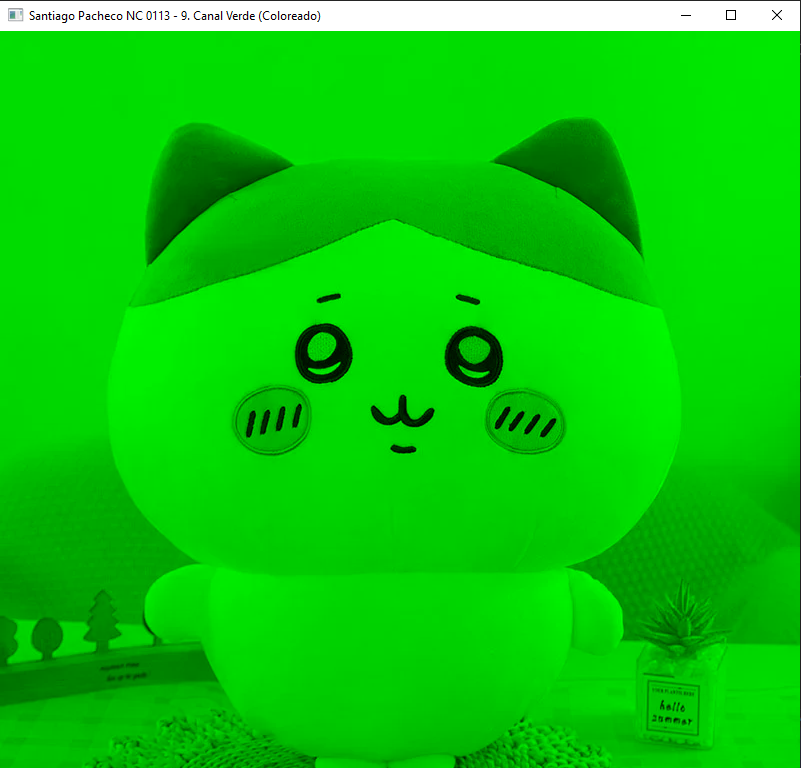
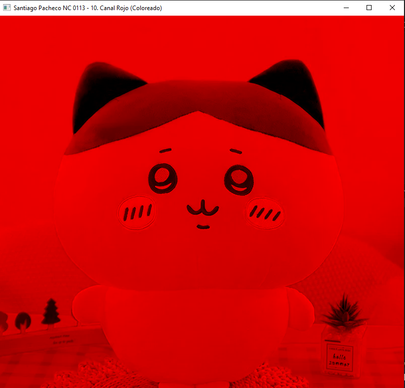

## imagenes redimencionadas
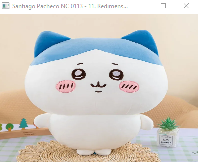

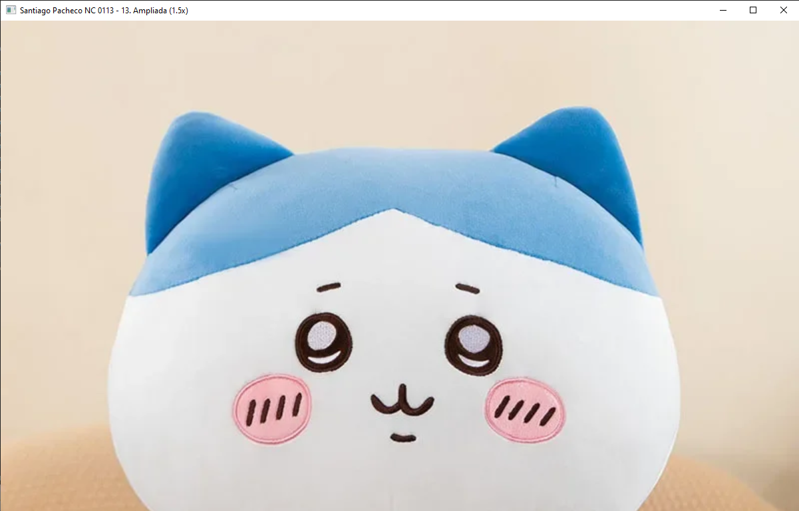

## 45 grados
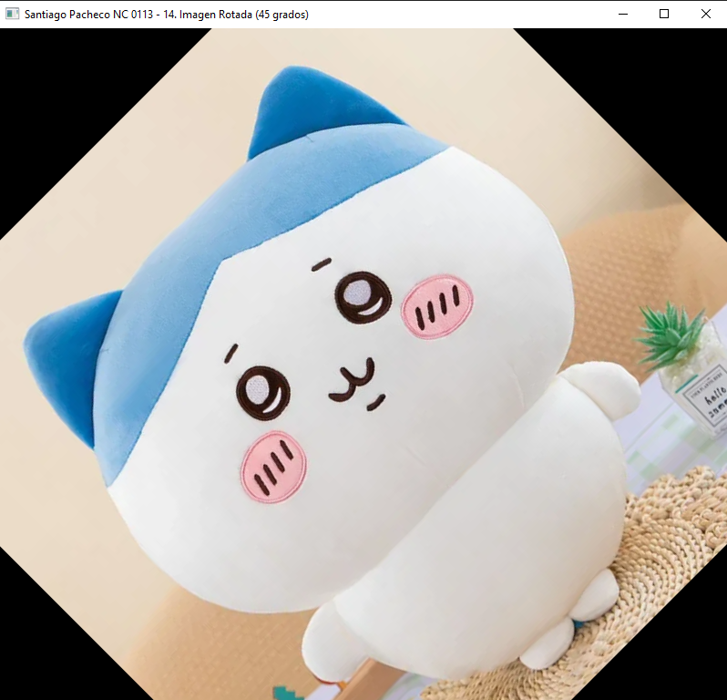

## cambio de ejes
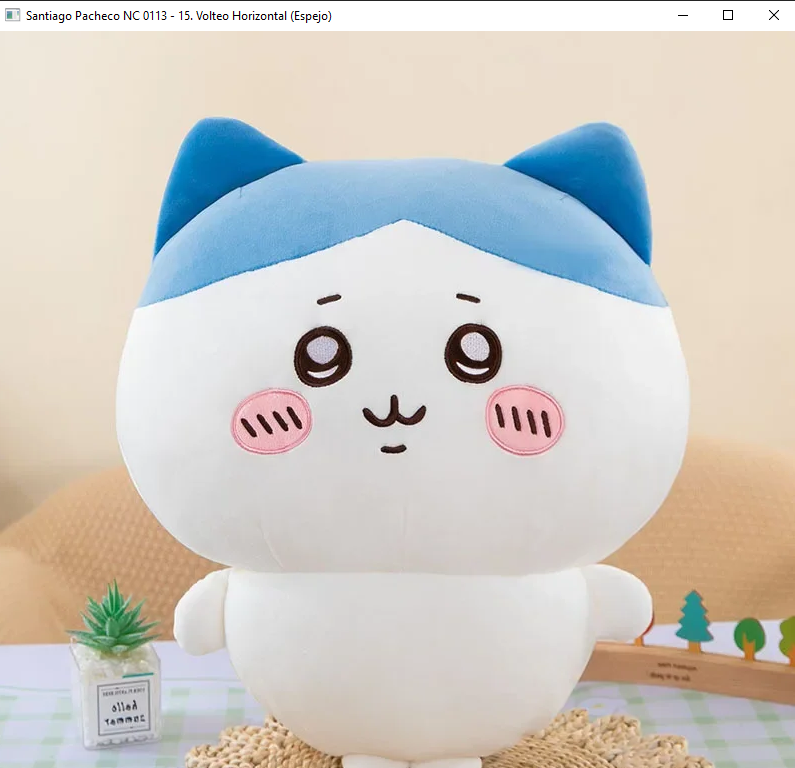
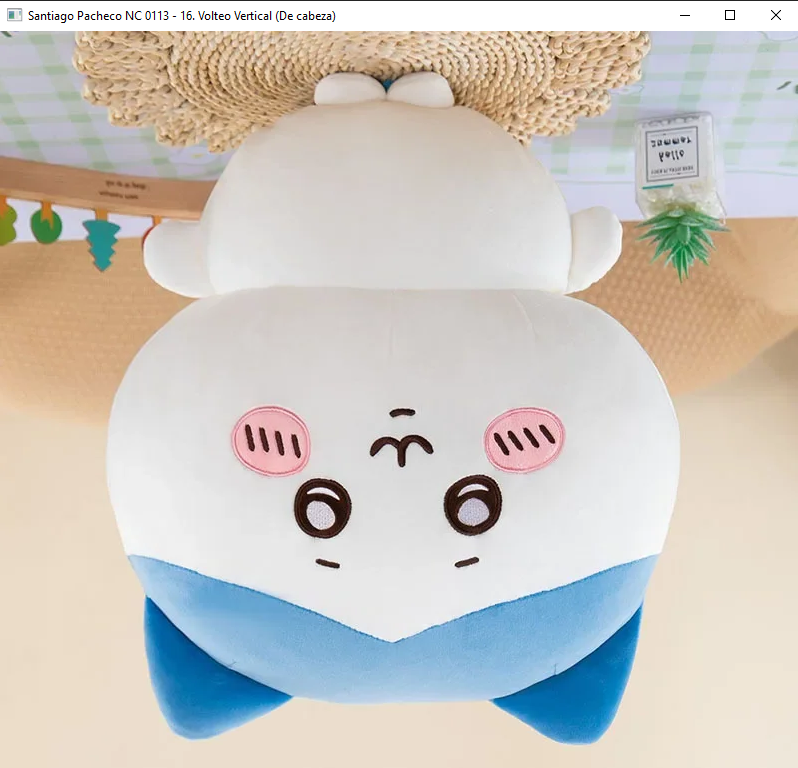
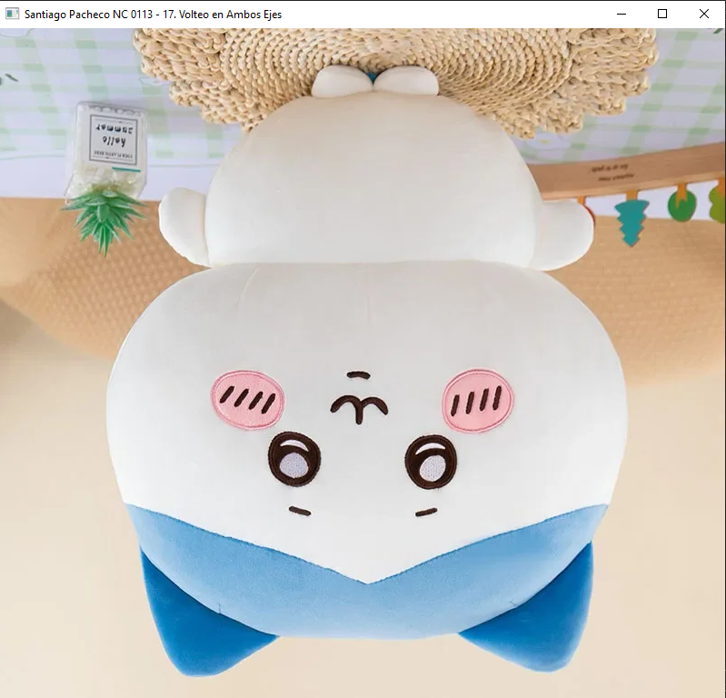
